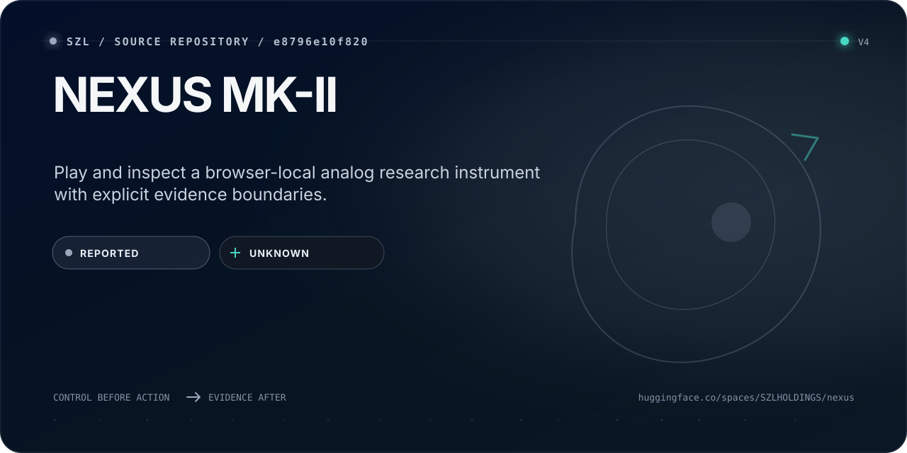
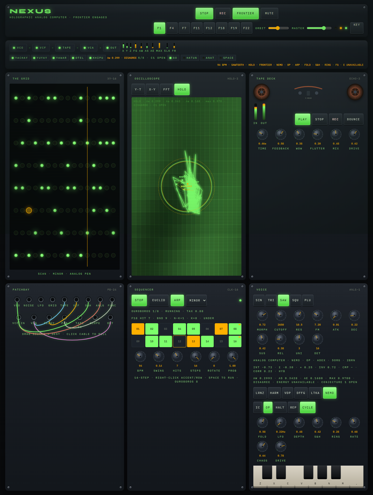

<!-- Native identity: szl-brand@4309f6fce89179331b0b3ed8c99494e76c5be256; Orbit v2 icon sha256 6e2b7d72a3af3d9602b79de41df0194ede6496a9661f057108ec224c0efc92e6. -->
<!-- Surface Foundry: szl-brand@b519affbd63447c086cb74b6e0636661bcac09a6; input README.surface.json; receipt README.surface-receipt.json. Generation metadata is not live runtime evidence. -->
<p><a href="https://github.com/szl-holdings"></a></p>

<!-- SZL-SURFACE-CARD:v3:START -->
<p align="center">
  <a href="https://huggingface.co/spaces/SZLHOLDINGS/nexus">
    
  </a>
</p>

> Play and inspect a browser-local analog research instrument with explicit evidence boundaries.

| Path | What a non-technical reader gets | Where a builder starts |
| --- | --- | --- |
| **Understand** | Explore the playable workstation and its six analog reference programs. | [Open the primary surface](https://huggingface.co/spaces/SZLHOLDINGS/nexus) |
| **Build** | Inspect source, local reproduction and the canonical publication contract. | [Inspect source](https://github.com/szl-holdings/nexus) |
| **Verify** | `REPORTED` evidence · `UNKNOWN` runtime | [Inspect evidence](https://github.com/szl-holdings/nexus/blob/00edebc993282efd5b43b0144b3d3d27ab43e264/README.md) |

<sub>Source presentation; provider and runtime readback are separate gates. IMMUNE is the read-only verification plane. Energy remains UNAVAILABLE; Λ remains Conjecture 1. A signature proves scoped integrity and origin; it does not prove accuracy, safety, performance, compliance, or authorization.</sub>
<!-- SZL-SURFACE-CARD:v3:END -->


<details>
<summary>Visual source and reproduction</summary>

This card is generated by [SZL Surface Foundry](https://github.com/szl-holdings/szl-brand/tree/b519affbd63447c086cb74b6e0636661bcac09a6) from [the reviewed source contract](https://github.com/szl-holdings/nexus/blob/main/README.surface.json). [The generation receipt](https://github.com/szl-holdings/nexus/blob/main/README.surface-receipt.json) binds its copy and SVG; it does not attest live publication or independent product verification.

At that exact brand revision, run `PYTHONPATH=src python -m szl_brand.surface /path/to/README.surface.json --output /tmp/szl-readme-card`. Copy the generated SVG to `readme-surface-card.svg` and the receipt to `README.surface-receipt.json`; update only the v3 managed block and preserve the surrounding source bytes.

Native SZL artwork is reused from its [licensed source](https://github.com/szl-holdings/szl-brand/blob/4309f6fce89179331b0b3ed8c99494e76c5be256/NOTICE) with CC BY 4.0 attribution to SZL Holdings and the source trademark reservation.

</details>

# NEXUS MK-II

<p align="center"></p>

**A playable research instrument, not another dashboard.** NEXUS combines a browser-local Web Audio synthesizer, sequencer, patchbay, tape deck and phosphor CRT with deterministic analog-dynamics references in TypeScript and Python. The Grok-origin visual language is preserved; SZL source binding, tests and fail-closed evidence boundaries make the public projection reproducible.

Holographic analog computer. Six programs. Optical core. Analog neuromorphic. Ouroboros. Five organs. Phosphor CRT.

Frontier is not a preset dump — it is a running analog computer. Six integrator programs (Lorenz, harmonic oscillator, van der Pol, Duffing, Lotka–Volterra, NEMO analog neuromorphic) with IC / OP / HALT / REP. A two-beam optical analog inner product reconstructs on the holographic CRT and folds the voice. The function generator is a rise/fall triangle. Those voltages drive voice cutoff, pan, fold, tape delay, the grid pen, and the hologram.

The SZL kernel is analog physics, not a seventh module. Ouroboros taxes amplitude over eight bounded bars. Eight falsifiable invariants hash the analog receipt chain. Five organs (YACHAY, YUYAY, YAWAR, OTel, KHIPU) fail-close the VCA. Hatun probes stay LIVE or honestly UNAVAILABLE. Energy is UNAVAILABLE — never a fabricated joule. Λ is advisory. Conjecture 1 remains OPEN.

Three aggregators run on the same 13 analog voltages: **Λw** (F19 weighted geometric mean), **Λs** (symmetric 1/13, A5 permutation invariance), **Λe** (Egyptian Horus-Eye 1/2+…+1/64 = 63/64, Theorem U). **maxAgg** is the live counterexample — same vector, different score. Disagreement is analog, not a mute. Unconditional uniqueness stays OPEN and false as stated.

Inspired by analog computing practice (THE ANALOG THING, CRT holograms, modular patchbays) — not a dashboard, not a generative-audio model.

| Module | Role |
| --- | --- |
| **The Grid** | 16×8 phosphor matrix. Write cells. Analog pen tracks analog X×Y. |
| **Oscilloscope** | Y-T, X-Y, FFT, **HOLO**. Hologram is a two-beam optical analog plus five organ nodes and a WILLAY conscience ring. |
| **Tape Deck** | Stereo echo with wow, flutter, saturation. Analog Z modulates delay time. Bounce dumps eight seconds. |
| **Patchbay** | Sources include **ANLG** and **FUNC**. Drag source → dest. Click a cable to pull it. |
| **Sequencer** | 16-step clock, Euclidean hits, swing, probability, arp. Ouroboros closes the loop at eight bars in Frontier. |
| **Voice** | Morph VCO, ladder-ish VCF, ADSR, unison, FM, folder, LFO, S&H, ring. Analog computer: **LRNZ / HARM / VDP / DFFG / LTKA / NEMO**, **IC / OP / HALT / REP**, Rate, Chaos, Drive. Live analog circuits: integrator, summer, multiplier, inverter, comparator, correlator. Analog Schmitt. Hybrid seq→S&H. Λ and energy UNAVAILABLE on the panel. |

Default chain: **VCO → VCF → DELAY → VCA → OUT**. Scope taps the master bus.

Frontier patch: **ANLG → VCF**, **FUNC → PAN**, **S&H → VCF**. ANLG is the analog computer jack (integrator + multiplier + analog correlator + WILLAY reconstruct). Analog Schmitt clocks S&H from the correlator. In Frontier the sequencer samples the correlator (hybrid ADC). REP accent loads analog IC (hybrid IC). F19: a DOWN organ mutes the VCA. Master cannot compensate.

## Analog computer

| Mode | What it does |
| --- | --- |
| **IC** | Hold initial conditions. Seed voltages freeze. |
| **OP** | Operate. Integrators run. The attractor lives. |
| **HALT** | Freeze the current state. CV stays put. |
| **REP** | Repetitive operation. Reseed the attractor on a period set by Rate. |

| Program | What it integrates |
| --- | --- |
| **LRNZ** | Lorenz (σ, ρ, β). Three integrators. |
| **HARM** | Harmonic oscillator. Two integrators, ω from Chaos. |
| **VDP** | van der Pol. Nonlinear damping μ from Chaos. |
| **DFFG** | Duffing. Cubic restoring + driven cosine. |
| **LTKA** | Lotka–Volterra. Prey/predator stay positive. |
| **NEMO** | Analog anatomy + second brain. Five AdEx organ-neurons: YACHAY cognition, YUYAY pacemaker, YAWAR traveling wave, OTel optical write, KHIPU bound. WILLAY optical ring is conscience — not a sixth organ. Tsodyks–Markram analog STP, three-factor optical STDP. Not a physical chip. |

Coefficient pots: Chaos maps onto the program’s analog coefficient. Rate is computer time (BrainScaleS-style acceleration on NEMO). Drive is injected current on YACHAY (cognition), YUYAY pacemaker If, and the analog neuromodulator (third factor) — not dopamine. YAWAR is the traveling analog wave around the organ ring. Optical analog: object beam (X,Y) interferes with reference beam (FG,Z). Reconstruction is WILLAY, the second brain, and folds the voice. NEMO uses the same optical inner product as a photonic synapse and as analog STDP eligibility. Analog correlator is a leaky product of X×Y (BrainScaleS analog-correlator job). Analog Schmitt is the analog event detector. Hybrid: the sequencer is the digital half — it samples the correlator into S&H, and a REP accent writes analog IC. Energy stays UNAVAILABLE — never a fabricated pJ/spike.

Inspired by analog computing practice (THE ANALOG THING, EAI hybrid IC/OP/HOLD, CRT holograms, modular patchbays) and analog neuromorphic literature (Izhikevich 2003; Brette & Gerstner AdEx 2005; BrainScaleS-2 analog correlators; Mead analog VLSI) — original analog-computer-native math, not a Loihi/BrainScaleS/THAT emulator, not a dashboard, not a generative-audio model.

## Kernel as voltages

| Organ | Quechua | Formulas | Analog face |
| --- | --- | --- | --- |
| BRAIN | YACHAY | F1 | Function generator. Read-only cortex. |
| HEART | YUYAY | F4 F11 | Λw weighted geometric mean. Zero axis fail-closes. Λs / Λe / maxAgg on the same 13 voltages. Disagreement is analog. Uniqueness OPEN. |
| CIRCULATORY | YAWAR | F7 F22 | SHA-256 analog receipt chain. |
| NERVOUS | OTel | F12 | Loop-tax. Energy UNAVAILABLE. Hatun probe. |
| SKELETON | KHIPU | F18 F19 | Locked-8. CHECKED ≠ Lean PROVEN @ c7c0ba17. |

WILLAY is conscience, not a sixth organ — the hologram ring. Analog anatomy lives on NEMO: YACHAY cognition, YUYAY pacemaker, YAWAR traveling wave, OTel optical write, KHIPU bound. Locked-proven exactly eight: F1 F4 F7 F11 F12 F18 F19 F22. ed25519 and flywheel stay UNAVAILABLE without a key or samples.

## Run it

**Launch Frontier** — unlocks Web Audio and boots the holographic analog computer.

Then play the keys, patch ANLG into VCF, watch HOLO, and throw Chaos.

- **Z–M** piano (shift = octave)
- **Space** run / stop sequencer
- **P** cycle scope Y-T / X-Y / FFT / HOLO; Tab remains standard keyboard navigation
- **F** Frontier · Shift-F disengage · F again reseeds the loop
- Voice: **IC / OP / HALT / REP**
- Scenes F1–F22 on the header (shift-click stores)
- **Esc** panic (all notes off)
- **?** shortcuts

Patterns, patches, tape, and voice settings persist in IndexedDB on the machine that played them. No account is required. Audio execution and user state remain browser-local; the canonical Space serves the prerendered workstation and its source-bound build identity from a Python standard-library runtime (`space/app_server.py`), while the Python engine remains the deterministic reference and parity implementation.

## Source and runtime authority

- **Source of truth:** [szl-holdings/nexus](https://github.com/szl-holdings/nexus).
- **Canonical organization Space target:** [`SZLHOLDINGS/nexus`](https://huggingface.co/spaces/SZLHOLDINGS/nexus), published only by the central exact-source workflow. A source merge alone does not establish that the Space exists, is current, or is running.
- **Origin preview:** [`betterwithage/nexus`](https://huggingface.co/spaces/betterwithage/nexus). Preserve it as the Grok-origin preview until the organization Space has immutable source readback and browser qualification; it is not the canonical publisher or proof authority.
- **IMMUNE verification plane:** [`SZLHOLDINGS/immune/nexus.html`](https://szlholdings-immune.hf.space/nexus.html) remains a read-only replay/verification surface, not a replacement for the playable workstation.
- NEXUS is a distinctive creative-research showcase inside SZL Holdings, **not a fourth commercial flagship** and not a production certificate for A11oy.

```bash
npm ci
npm run dev
```

The source-bound container uses `space/Dockerfile`; `/healthz` and `/api/build-info` disclose readiness and the exact publisher-injected Git revision without authorizing external effects.
